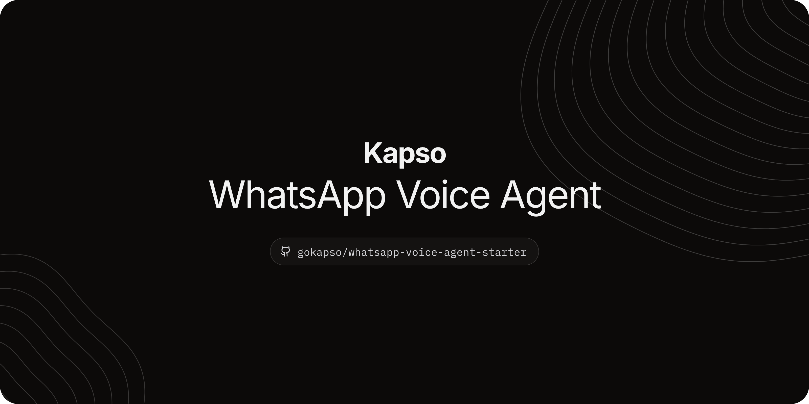

# Kapso WhatsApp voice agent starter



Answer WhatsApp calls with your own AI front desk. Riley, the sample agent, says it is an AI
and answers questions about your business. After a clear yes, it books, moves or cancels
appointments in your [Cal.com](https://cal.com) calendar.

## How the parts fit

- **Kapso** owns your WhatsApp number, your messages and the call API.
- **This starter** is one small server. It answers the call through Kapso, carries the audio,
  runs the six calendar tools and gives you a console for test calls.
- **The voice provider** listens, thinks and speaks: [ElevenLabs Agents](https://elevenlabs.io/docs/eleven-agents)
  or [Grok Voice](https://docs.x.ai/developers/model-capabilities/audio/speech-to-speech).
  You choose one with `VOICE_PROVIDER`. This choice does not change where the server runs.
- **Railway** is the recommended host for the server. A Linux server with a public IP also works.

```
WhatsApp caller → Meta → Kapso ─signed webhook→ this server ←→ ElevenLabs or Grok
                                                    └──→ your tools → Cal.com
```

You run one server for one number, with either provider. You do not need a separate Railway
service for each provider. [`docs/deploy.md`](docs/deploy.md#other-ways-to-run-calls) explains
the other options and why a provider cannot answer a Kapso number directly today.

## Get started

You need:

- A Kapso project and a dedicated WhatsApp number with Calling enabled.
- An API key for one voice provider: [ElevenLabs](https://elevenlabs.io/app/settings/api-keys)
  (with Agents access) or [xAI](https://console.x.ai) for Grok Voice.
- Python 3.12, [uv](https://docs.astral.sh/uv/) and a [Railway](https://railway.com) account.

### 1. Set up

```sh
uv sync
uv run voice-agent setup --host railway --whatsapp   # provider, calendar, Kapso key and number; keys are typed hidden
uv run voice-agent check
uv run voice-agent agent apply --yes --save-agent-id    # ElevenLabs only: creates the agent
```

`setup` tells you what is left. For a first test, choose the local development calendar. For
real bookings, fill in `agent/business.json` and run `uv run voice-agent calendar check`
([`docs/customize.md`](docs/customize.md)).

### 2. Hear it in your browser (optional)

```sh
uv run voice-agent serve
```

Open <http://127.0.0.1:8080/operator/>. Sign in with the **console access key**:
`uv run voice-agent console-key` copies it to your clipboard. This key (`OPERATOR_TOKEN`) opens
the console of your server only. It is not a Kapso or provider key.

Select **Start test call**, allow the microphone, and book, move or cancel an appointment. Each
test call is a real provider session that the provider bills per minute.

### 3. Deploy to Railway

Follow [`docs/deploy.md`](docs/deploy.md). In short: create the project with the Railway CLI,
set the variables with `uv run voice-agent railway variables --yes`, then `railway up`.

### 4. Connect your Kapso number

On Railway, this happens by itself: at startup the server registers its URL as your number's
webhook in Kapso, if the number has none. Open the console on your Railway URL: the WhatsApp row
says whether the webhook points to this server. On other hosts, register it with
`uv run voice-agent kapso webhook --url https://<host>/webhooks/whatsapp --yes`.

### 5. Call the number from a phone

Call the number from WhatsApp. Riley answers. The console on your Railway URL shows the call
under **Recent calls**. A configured number is not proof: only a phone call shows that WhatsApp
audio reaches your server.

## Change the agent

Point your coding agent (Claude Code, Cursor, Codex) at [`AGENTS.md`](AGENTS.md) and
[`docs/customize.md`](docs/customize.md). The guide has a ready-made request that sets Riley up
for your business. The main files are [`agent/prompt.md`](agent/prompt.md),
[`agent/agent.toml`](agent/agent.toml), [`agent/business.json`](agent/business.json) and
[`src/kapso_voice_agent/tools.py`](src/kapso_voice_agent/tools.py).

## Docs

- [`docs/deploy.md`](docs/deploy.md): Railway, other hosts, Kapso and the phone check
- [`docs/customize.md`](docs/customize.md): your business, Cal.com, the prompt and the tools
- [`docs/testing.md`](docs/testing.md): offline tests, the browser checklist and the phone check
- [`docs/security.md`](docs/security.md): console access, caller isolation, recordings and logs
- [`docs/architecture.md`](docs/architecture.md): call flow, source map and contracts

## License

MIT. See [`LICENSE`](LICENSE).
